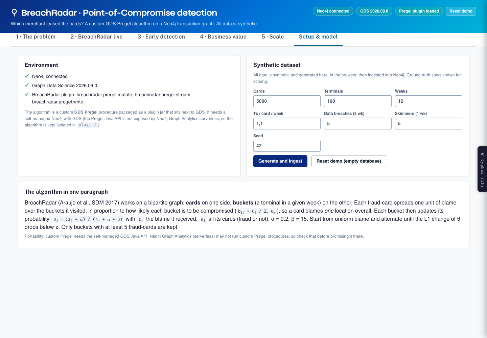
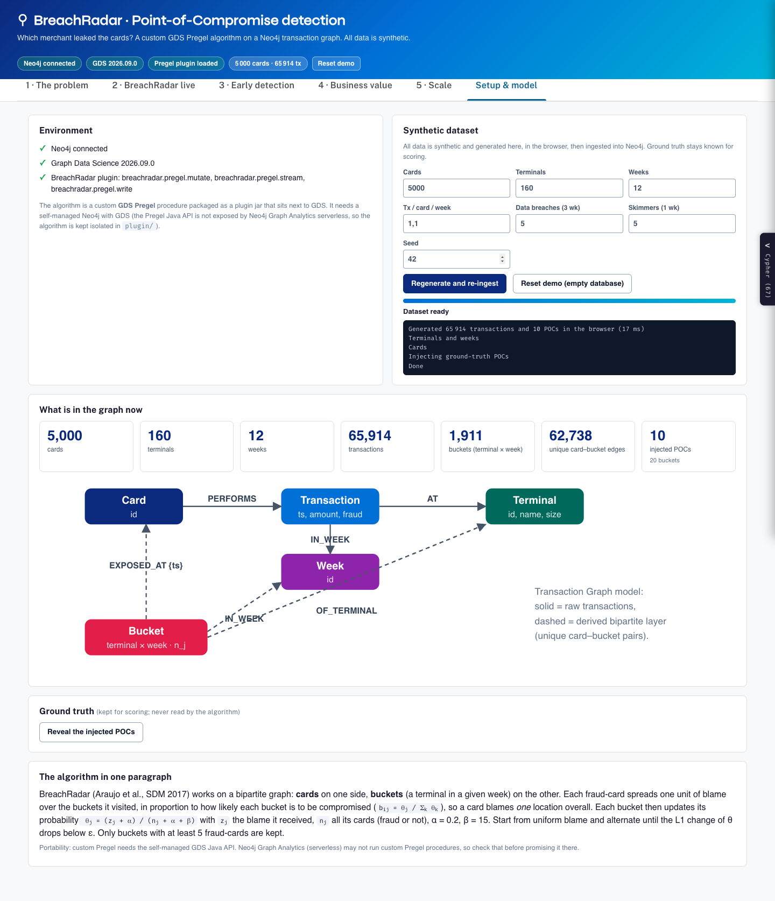
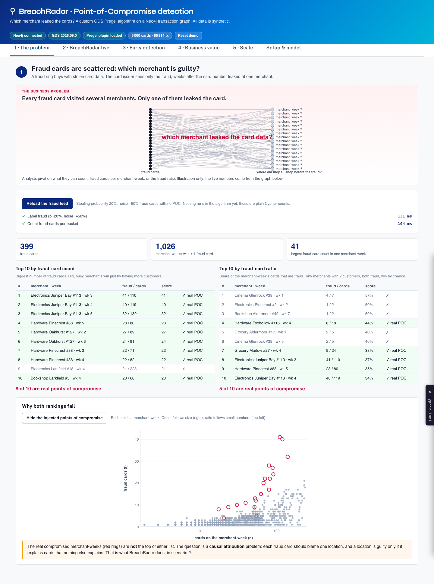
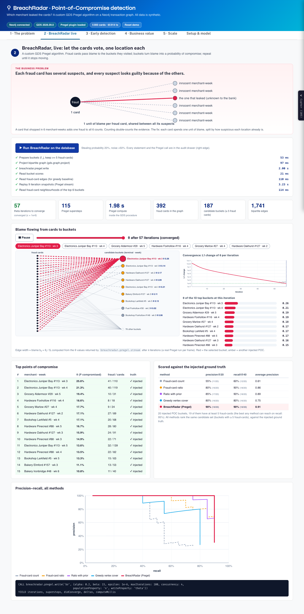
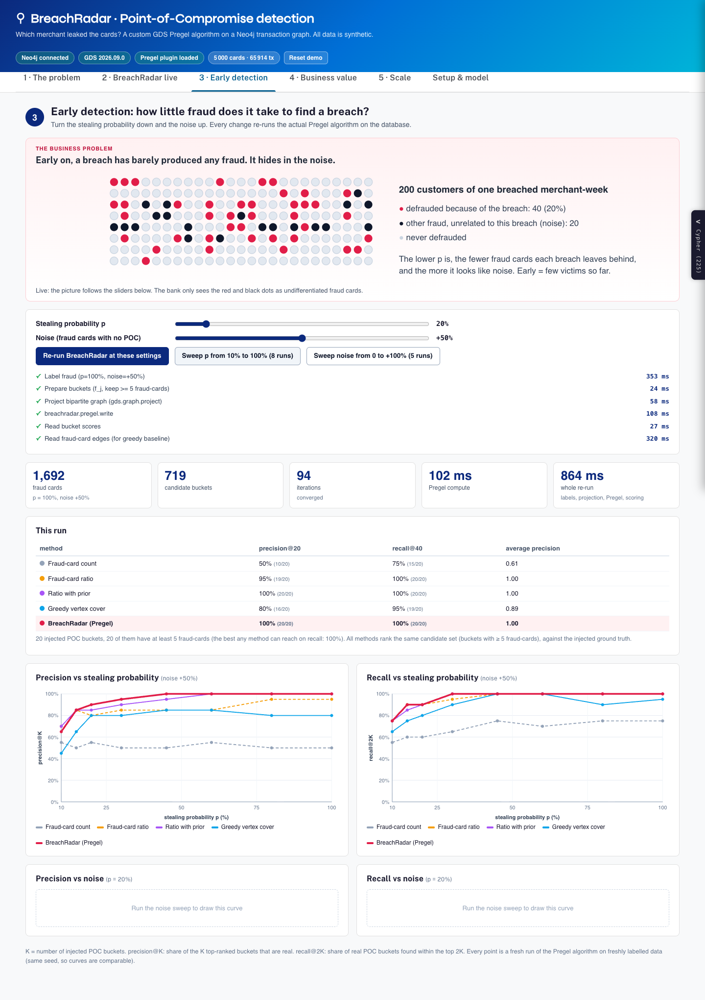
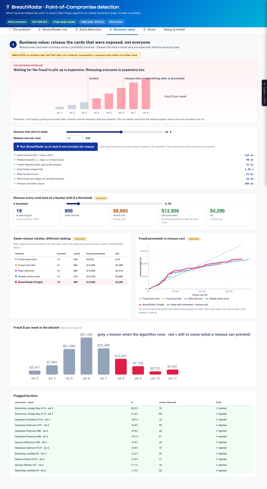
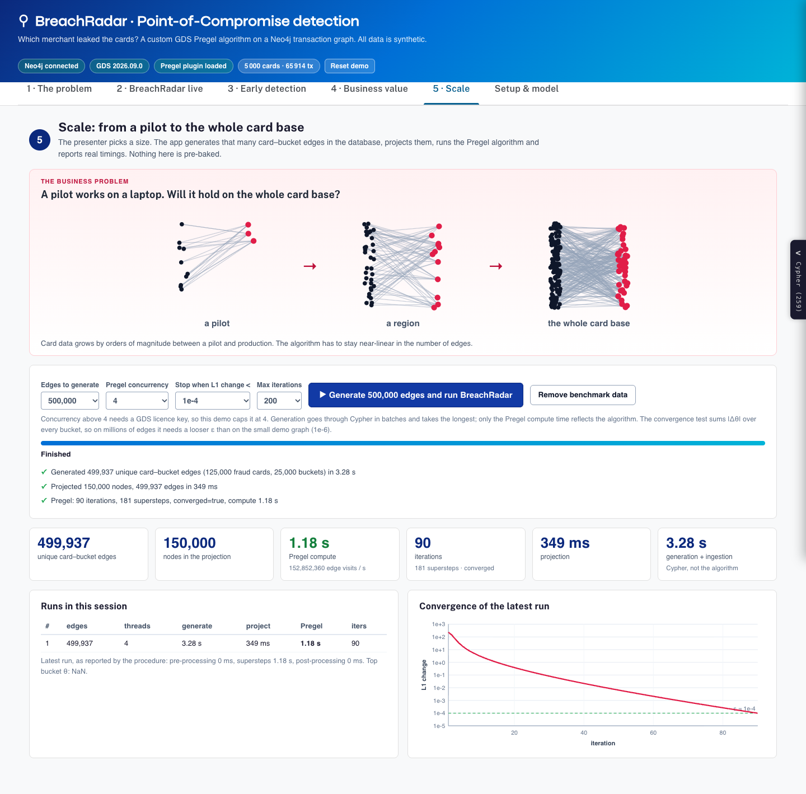
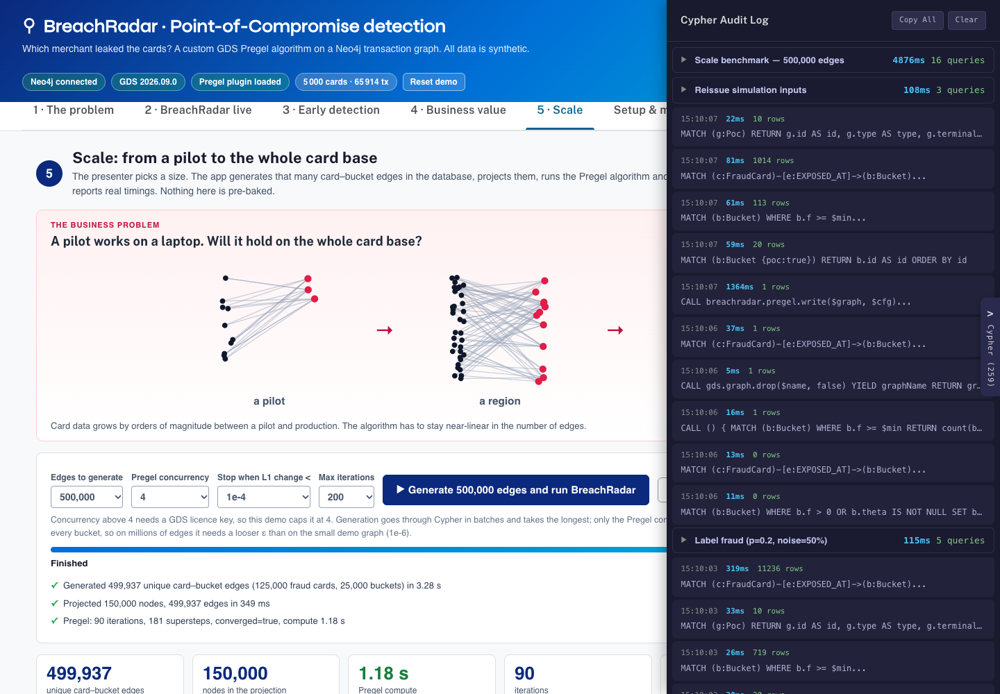

# BreachRadar: Point-of-Compromise detection on Neo4j

A demo of **BreachRadar** (Araujo et al., *Identifying Points of Compromise in Credit Card Fraud*, SDM 2017, Feedzai / CMU), implemented as a **custom GDS Pregel algorithm** and driven from a React app. Built for a PNC conversation. **All data is synthetic**; nothing here is PNC data, and no PNC facts are assumed beyond "runs self-managed GDS".

The question it answers: *fraud cards are scattered across thousands of merchants. Which merchant-week actually leaked the card data?*

## Quick start

```bash
cp .env.example .env     # already provided with local Docker defaults; edit if you use your own Neo4j
make plugin              # starts Neo4j+GDS in Docker, builds the Pregel jar, deploys it next to GDS, restarts
make test                # Pregel procedure vs numpy reference, tolerance 1e-6
make app                 # UI on http://localhost:5173
```

Then open the **Setup & model** tab and press **Generate and ingest**: the app generates the synthetic dataset in the browser and ingests it into an empty database (about 5 s). **Reset demo** (header) returns to an empty database at any time. There is no seed script.

`.env` keys: `NEO4J_URI`, `NEO4J_USER`, `NEO4J_PASSWORD`, `NEO4J_DATABASE` (plus `NEO4J_BOLT_PORT`, `NEO4J_HTTP_PORT`, `NEO4J_IMAGE` for docker-compose). The defaults use Bolt on **7699** because 7687 is commonly taken by another local Neo4j. The password in `.env.example` is a local-Docker demo value; change it for anything shared. The Vite app reads the same `.env` and exposes the `NEO4J_*` keys to the browser bundle: **local demo only, never deploy it publicly.**

Requirements: Docker, JDK 21, Node 22+, Python 3 with `numpy` and `neo4j` (for `make test`).

## The algorithm

Bipartite graph: **cards** on one side, **buckets** (terminal × week) on the other. Edges are unique card–bucket pairs (multi-edges removed). Only buckets with at least 5 fraud-cards are kept. A fraud-card has at least one fraudulent transaction, and only the buckets it visited *before* its first fraud count.

Per bucket *j*: `n_j` = all cards on it (fraud or not, precomputed), `θ_j` = probability it is compromised.
Per fraud-card *i*: blame `b_ij = θ_j / S_i`, `S_i = Σ_k θ_k` over its buckets, so one card blames one location overall. Non-fraud cards send nothing.
Bucket update: `z_j = Σ_i b_ij`, `θ_j = (z_j + α) / (n_j + α + β)`, α = 0.2, β = 15.
Start from uniform blame `1 / deg(i)`, alternate until `Σ_j |θ_j − θ_j(prev)| < ε`.

### Pregel mapping (checked against the installed GDS 2026.09.0 jar with `javap`)

Scalar messages only, `Reducer.Sum`, phases by superstep parity ([`BreachRadar.java`](plugin/src/main/java/breachradar/BreachRadar.java)):

| superstep | who | does |
|---|---|---|
| 0 | fraud card | sends `1/deg(i)` to its buckets (uniform blame) |
| odd | bucket | `z = Σ messages` (first time) or `θ_old · Σ messages` (later); `θ = (z+α)/(n+α+β)`; records `|Δθ|`; sends `θ` to its cards |
| even ≥ 2 | fraud card | `S_i = Σ received θ`; sends `1/S_i` to its buckets |
| master, after odd ≥ 3 | – | sums `|Δθ|` over buckets, stops when `< ε` |

The bucket's summed `1/S_i` makes `z_j = θ_j · Σ_i 1/S_i`, which is exactly `Σ_i θ_j/S_i`, so no per-edge state is needed.

### Procedures

```cypher
CALL breachradar.pregel.stream('graph', {alpha: 0.2, beta: 15, epsilon: 1e-6, maxIterations: 100, concurrency: 4, populationProperty: 'n'})
CALL breachradar.pregel.mutate('graph', {... , mutateProperty: 'theta'})   // in-memory graph property + run statistics
CALL breachradar.pregel.write('graph',  {... , writeProperty:  'theta'})   // database property + run statistics
```

Statistics returned by mutate/write: `iterations`, `supersteps`, `didConverge`, `finalDelta`, `deltas` (the whole convergence curve), `preProcessingMillis`, `computeMillis`, `postProcessingMillis`, node/edge counts.

### Generic by design

The procedure knows nothing about cards or terminals. It needs an undirected bipartite projection and one numeric node property (`populationProperty`, default `n`): victims carry 0, candidate causes carry the number of entities exposed to them. Re-pointing it to another vertical (for example lot traceability: complaints vs production lots) only changes the projection query. Not built here, on purpose.

## Validation against a reference

[`reference/breachradar_ref.py`](reference/breachradar_ref.py) is a plain numpy implementation of the same algorithm. [`reference/test_equivalence.py`](reference/test_equivalence.py) builds random bipartite instances in the database, projects them, runs `breachradar.pregel.stream` and compares θ per bucket, the iteration count and the convergence curve with the reference, also for a run truncated at 3 iterations (the UI's iteration replay relies on that). Output of `make test` ([`reference/last_run.txt`](reference/last_run.txt)):

```
instance  0: cards=132 buckets=57 edges= 475 iters pregel=33 ref=33  max|theta diff|=5.55e-17 (3-iter run 5.6e-17)  OK
...
instance 19: cards=193 buckets=20 edges= 672 iters pregel=30 ref=30  max|theta diff|=1.11e-16 (3-iter run 1.7e-16)  OK

20 instances, mismatches=0, worst theta diff=1.67e-16, worst delta-curve diff=6.52e-16 (tolerance 1e-6)
```

## Data model

Follows the Neo4j *Transaction Graph* pattern for financial services, with a derived bipartite layer:

```
(:Card)-[:PERFORMS]->(:Transaction)-[:AT]->(:Terminal)
(:Transaction)-[:IN_WEEK]->(:Week)
(:Bucket)-[:OF_TERMINAL]->(:Terminal), (:Bucket)-[:IN_WEEK]->(:Week)         derived
(:Card)-[:EXPOSED_AT {ts}]->(:Bucket)        unique card–bucket pairs       derived
(:Poc)-[:COMPROMISED]->(:Bucket)             ground truth, used only for scoring
```

Fraud labels are `:FraudTx` transactions and `:FraudCard` cards; they are rewritten whenever the sliders change.

## Synthetic data

Generated in the browser ([`gen.ts`](app/src/lib/gen.ts), seeded, reproducible): log-normal terminal popularity, cards with favourite terminals, injected POCs of two types (data breach: a large terminal over 3 consecutive weeks; skimmer: a medium terminal for 1 week), stealing probability `p` per exposed card, cash-out 1 to 3 weeks later at random terminals, and **noise cards** marked as fraud with no POC behind them (as a % of the compromised cards, up to +100%). Ground truth stays known.

## The five scenarios

Each opens with a synthetic visual of the business problem, then runs the real algorithm. Every Cypher statement and procedure call appears in the **Cypher audit drawer** (right edge).

1. **The problem.** Naive rankings (fraud-card count, ratio) computed live. Count favours big busy merchants, ratio favours tiny ones by chance; a scatter plot with the injected POCs revealed shows why.
2. **BreachRadar live.** Runs the Pregel procedure, shows the steps and timings, replays iterations (each frame is a real `stream` run with `maxIterations = k`), the blame flowing from cards to buckets, the θ convergence curve, top POCs with probabilities, and precision/recall against the injected ground truth next to the baselines.
3. **Early detection.** Sliders for `p` (down to 10%) and noise (up to +100%); each change re-labels the data and re-runs the algorithm. Sweep buttons draw precision/recall curves, one fresh run per point.
4. **Business value.** Decision at the end of a chosen week (the algorithm only sees fraud known by then); reissue every card seen at buckets with θ above a threshold; compare fraud prevented with the reissue cost (default $10 per card, editable) and with the baselines at equal reissue volume. **Labelled as simulated on synthetic data**; assumes a reissued card suffers no further fraud.
5. **Scale.** The presenter picks 100k to 5M edges; the app generates them in the database, projects, runs Pregel and reports measured timings and iteration counts. Nothing is pre-baked. Generation and ingestion are Cypher (slowest); the Pregel compute time is the algorithm. The convergence threshold is selectable because the L1 sum grows with the number of buckets.

### Baselines

Fraud-card count, fraud-card ratio, ratio with prior `(f+α)/(n+α+β)`, greedy vertex cover (pick the bucket with the most fraud-cards, remove its cards, repeat), in [`eval.ts`](app/src/lib/eval.ts). Scenario 1 ranks all buckets with at least one fraud-card, as an analyst's pivot table would. From scenario 2 on, **all methods rank the same candidate set** (buckets with ≥ 5 fraud-cards) for a fair comparison. Metrics: precision@K and recall@2K with K = number of injected POC buckets, plus average precision.
FaBP is **not** built; it is waiting for your go-ahead.

### What to say, and what not to

Measured during the build on one machine (Docker, GDS concurrency 4, seeded data, a single seed, so treat as indicative, not a benchmark):

- Default labelling (p = 20%, noise +50%): BreachRadar is at the top of the comparison with 80–90% precision@K, ahead of count and ratio. **"Ratio with prior" is a strong baseline and ends close behind**; greedy vertex cover degrades first when noise grows. Do not claim a large gap over every baseline: show the curves live and let them speak.
- Scale: 5M unique edges (1.25M fraud cards, 250k buckets): generation and ingestion about 44 s (Cypher), projection under 1 s, Pregel about 12 s for 117 iterations (235 supersteps) to ε = 1e-4. 1M edges: about 2.4 s for 100 iterations. Tiny graphs pay a fixed cost of roughly 10 ms per superstep, so the 5k-card demo takes about 1.5 s per run.

## Portability

- **Self-managed GDS (what PNC runs):** the Pregel Java API is available, so this plugin loads next to GDS. The class is a normal `@Procedure` that drives `Pregel.create(...)` directly; the `@PregelProcedure` annotation processor is not shipped in the GDS jar. Internal GDS APIs move between versions: rebuild against the target GDS jar (`plugin/build.sh`).
- **Neo4j Graph Analytics (serverless):** it may not support custom Pregel procedures, so the algorithm is deliberately isolated in `plugin/` and the app only calls three procedure names. Check this before promising a managed deployment; if it is a blocker, the numpy reference shows the exact semantics for a re-implementation.
- Concurrency above 4 needs a GDS licence key; the demo caps at 4.

## Layout

```
plugin/        Java Pregel algorithm + build.sh (javac against the GDS jar of the running container)
reference/     numpy reference + equivalence test + last_run.txt
app/           React 19 + TypeScript + Vite; neo4j-driver singleton, typed queries (lib/db.ts), audit drawer, hand-rolled SVG
app/scripts/   e2e.ts (full pipeline, headless), bench.ts (scale, headless)
tools/tune.ts  dev-only: generator tuning with an in-memory TS copy of the algorithm
docker-compose.yml, Makefile, .env.example
```

## Screenshots

Captured from the running app with synthetic data (default seed, p = 20%, noise +50%). Timings are from the capture machine.

**Setup: empty database, then in-app generation and ingestion**




**1. The problem: naive rankings and why they fail**



**2. BreachRadar live: iterations, blame flow, convergence, scoring**



**3. Early detection: p and noise sweeps, each point a fresh Pregel run**



**4. Business value (simulated on synthetic data)**



**5. Scale benchmark (500k edges here; the presenter chooses the size)**



**Cypher audit drawer: every statement and procedure call**


